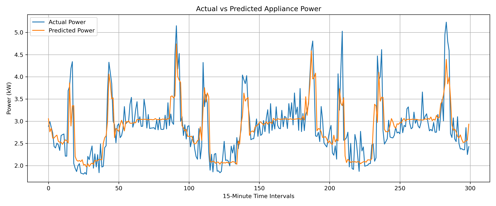
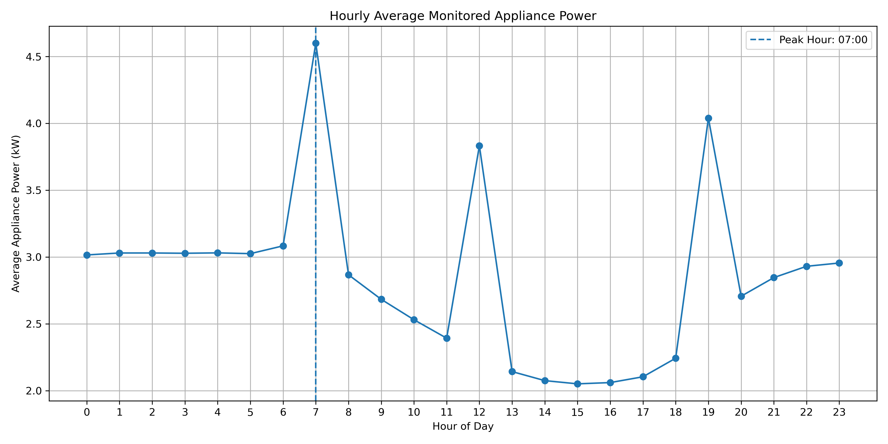
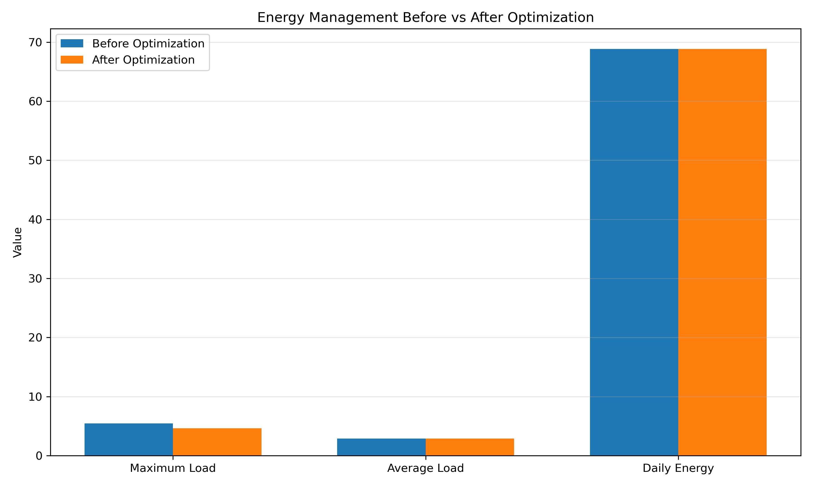

# Smart Energy Consumption Prediction and Optimization

A Python project for household electricity-consumption analysis, machine-learning evaluation, peak-load analysis, and appliance scheduling with SciPy's mixed-integer linear optimization solver (MILP), presented through a Streamlit dashboard.

## Overview

The project provides an interactive dashboard for exploring energy data, viewing prediction metrics, inspecting hourly demand, and comparing baseline and optimized load profiles.

## Features

- Streamlit dashboard with dataset, prediction, peak-load, and optimization views
- Random Forest model training and evaluation
- Hourly energy-consumption analysis
- Mixed-integer optimization for appliance scheduling
- CSV results and graph visualizations

## Technologies

- Python 3
- Streamlit
- Pandas and NumPy
- scikit-learn
- SciPy
- Matplotlib
- Joblib

## Evaluated Project Results

The following results were reproduced using the project's existing evaluation scripts and saved Random Forest model.

| Metric | Evaluated result |
|---|---:|
| Peak monitored load before optimization | 5.453183 kW |
| Peak monitored load after optimization | 4.635425 kW |
| Peak-load reduction | 15.00% |
| Daily energy consumption before optimization | 68.827259 kWh |
| Daily energy consumption after optimization | 68.827259 kWh |
| Mean Absolute Error (MAE) | 0.302053 kW |
| Root Mean Squared Error (RMSE) | 0.425657 kW |
| R² score | 0.610869 |

### Evaluation Methodology

- **Prediction evaluation:** The existing saved Random Forest model was evaluated on a reconstructed chronological test set containing 6,700 samples. The resulting MAE, RMSE, and R² matched the values displayed in the dashboard.
- **Optimization evaluation:** The evaluation script compared baseline and optimized monitored-load profiles, reporting a 15.00% reduction in peak load while maintaining the same daily energy consumption.
- **Optimization assumptions:** The project assumes that 30% of flexible load can be shifted, subject to the appliance scheduling constraints.

The optimization implementation in `src/optimization.py` uses `scipy.optimize.milp` to select appliance start times while minimizing maximum hourly load subject to scheduling constraints.

These results describe the project's evaluation and modeled optimization scenario; they do not establish real-world household energy savings. The prediction metrics were reproduced using a reconstructed test set, and the original dataset provenance and complete evaluation workflow still require documentation.
## Repository Structure

```text
Smart_Energy_Optimization/
├── app.py
├── src/
│   ├── train_model.py
│   └── optimization.py
├── data/                 # Required data files; not included in GitHub
├── models/               # Trained models; large model stored externally
├── graphs/               # Visualization outputs
├── results/              # CSV outputs
├── requirements.txt
└── README.md
```

## Dataset and Model Files

The Streamlit dashboard expects the processed dataset at:

```text
data/homec_processed.csv
```

The training script `src/train_model.py` separately expects:

```text
data/processed_energy_data.csv
```

The large trained model is expected at:

```text
models/random_forest_energy_model.pkl
```

These files are excluded from the GitHub repository because of their size. **The original dataset source and public download location have not yet been verified for this repository.** Do not assume that a similarly named public dataset is the exact source. Before running the project, obtain the correct files from the project owner and ensure you have permission to use them.

- Dataset download: **to be added after source verification**
- Large model download: **to be added after external upload**

The smaller model `models/homec_random_forest_model.pkl` and the graph/result files may be present in the repository.

## Screenshots and Results

The following figures are committed to the repository and provide a preview without requiring the dataset or trained model to run the dashboard.

### Predicted vs. Actual Power



### Hourly Peak Load



### Before and After Optimization



## Installation

1. Install Python 3 and Git.
2. Clone the repository:

   ```bash
   git clone https://github.com/spandan-s-afk/Smart_Energy_Optimization.git
   cd Smart_Energy_Optimization
   ```

3. (Recommended) Create and activate a virtual environment on Windows PowerShell:

   ```powershell
   python -m venv .venv
   .\.venv\Scripts\Activate.ps1
   ```

4. Install the dependencies:

   ```bash
   python -m pip install --upgrade pip
   pip install -r requirements.txt
   ```

5. Obtain the required dataset file and place it at `data/homec_processed.csv`. If you intend to run the training script, also provide `data/processed_energy_data.csv`.

## Run the Dashboard

From the repository root, run:

```powershell
streamlit run app.py
```

Streamlit will display a local URL, usually `http://localhost:8501`, to open in your browser.

## Train the Model (Optional)

After placing the expected training dataset at `data/processed_energy_data.csv`, run:

```bash
python src/train_model.py
```

This script writes `models/random_forest_energy_model.pkl`. Training may require substantial memory and processing time depending on dataset size.

## Limitations

- Required datasets and the large trained model are not bundled with the repository.
- The original dataset source and preprocessing provenance still need confirmation.
- Prediction metrics depend on the data, feature engineering, and evaluation methodology.
- Optimization results depend on the model's assumptions and scheduling constraints.

## Author

Spandan

## Disclaimer

This project is intended for academic and educational purposes. Confirm the data license and model provenance before redistribution.
